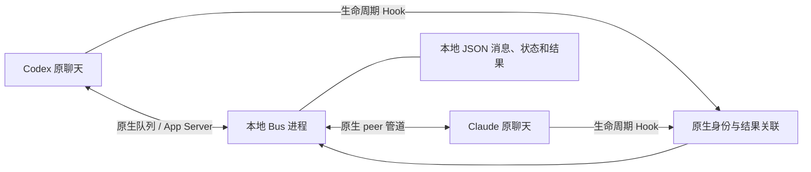

# AgentWire · 搭线

**让已经打开的 Codex Desktop 与 Claude Code 聊天互相委派任务，结果自动回到原窗口。**

Local, bidirectional collaboration between existing Codex Desktop and Claude Code chats. Windows preview · v0.1.1 · MIT.

在 Codex 中说「让 Claude 只读审查当前修改」，或在 Claude 中说「让 Codex 分析这个问题」。双方保留独立上下文和现有登录，不用复制完整聊天，也不用让模型记住消息编号、执行回信命令。

> 首版是 Windows 技术预览，依赖两端的原生队列、peer 通道及 Hook 能力。已验证的版本组合见[兼容性与验收边界](docs/CLEAN-MESSAGES-ACCEPTANCE.md)，不承诺所有 CLI 版本都能连接。它不是 MCP Server，也不是通用多 Agent 编排平台。

## 安装

准备好 **Node.js 24 或更新版本**，并在本机安装、登录 Codex Desktop 和 Claude Code。

下载 [v0.1.1 Windows 安装包](https://github.com/kyy-logs/agentwire/releases/tag/v0.1.1)，解压后在目录中运行：

```powershell
powershell -NoProfile -File .\install.ps1
```

安装器先展示将要修改的文件与用户 PATH，输入 `yes` 后应用；之后按提示在两端审核原生 Hook。不会下载运行时、代替信任确认或修改工具审批。首版暂保留兼容命令 `labus` 和 `%LOCALAPPDATA%\LocalAgentBus` 安装目录。

也可以从源码安装：

```powershell
git clone https://github.com/kyy-logs/agentwire.git
cd agentwire
powershell -NoProfile -File .\install.ps1
```

现有 PowerShell 策略不允许运行脚本时，保留策略，按照[安装文档](docs/INSTALL.md)使用 Node 入口预览。不需要 `npm install`，零第三方运行依赖。

### 连接码开发预览

`codex/pairing-codes-mvp` 分支包含新聊天连接码配对及 Codex 沙箱兼容修复，尚未打包为新 Release；上面的 v0.1.1 安装包不包含这些更新。从该分支试用：

```powershell
git clone --branch codex/pairing-codes-mvp https://github.com/kyy-logs/agentwire.git
cd agentwire
powershell -NoProfile -File .\install.ps1
```

在目标 Claude 聊天输入「生成连接码」，再在目标 Codex 聊天以纯文本输入「连接 Claude，连接码 XXXX-XXXX」。新码一小时有效、一次使用，支持双方不同工作目录；反向发码使用程序返回的兑换句式。仍只允许一组活动配对，更换前应正常断开旧配对。原生执行审批继续生效，配对成功与实际任务往返分别验证，详见[配对验收](docs/PAIRING-ACCEPTANCE.md)。

`codex/local-connections-p0` 开发分支进一步支持「列出这个聊天保存的连接」和已配对历史连接的预览、安全切换，以及分环节的 doctor 诊断；不在上述 v0.1.1 安装包或旧版用户 Skill 中。切换保留历史、检查在途工作，仍只维持一组活动配对，详见[本机连接管理 P0](docs/LOCAL-CONNECTIONS-P0.md)。

该分支包含后续的生命周期和断开恢复修复，完整离线测试 324/324。同一对原窗口的历史恢复及恢复后正向往返已验证，其他范围见[真实窗口验收](docs/LOCAL-CONNECTIONS-P0-LIVE-ACCEPTANCE.md)与[修复记录](docs/LOCAL-CONNECTIONS-P0-REPAIR.md)。源码试用时将上面 clone 命令的分支名改为 `codex/local-connections-p0`。

## 开始协作

1. 打开想连接的两个聊天。
2. 在 Codex 中说：**「列出可以连接的 Claude 聊天，让我选。」**
3. 选择目标，等待双向探针完成、连接状态成为 `ready`。若窗口需结束当前回合才能处理队列，先正常结束再检查。
4. 说：**「让 Claude 只读审查当前项目的修改，不要改文件。」**
5. Claude 正常处理和回答；程序关联原生回合，自动将结果送回。需要下一轮时明确提出修改或补充要求。

反方向也一样。在 Claude 中说「连接我打开的 Codex」，再说「让 Codex 分析……」。如自然语言没有触发入口，可显式调用已安装的 `labus` Skill。原生工具审批仍可能需要你确认。

## 工作方式



Skill 负责发起明确任务；Bus 负责路由、持久化、有限重试与状态；Hook 和原生记录负责识别精确回合、收集结果。聊天正文不携带协议编号，编号保存在后台。回复属于对方提供的数据，不提升指令权限。

## 当前边界

- 一组活动的 Codex ↔ Claude 连接；没有第三 Agent、多连接或开机自启。
- 不额外接入模型 API，使用现有登录；两家产品本身的订阅与用量规则仍适用。
- 未知投递暂停核对，不盲重发；不承诺原生执行 exactly-once。
- 超时或 Bus 停止不等于取消 Agent 已启动的工具。
- 每个任务家族最多 6 次执行、30 分钟期限，结果等待 10 分钟；不会自动无限对话。
- Bus 不做文件写入互斥。推荐一个 Agent 写代码、另一个只读审查；并行写入使用独立 Git worktree。
- “本回合已结束”只表示采集到了输出，业务结论仍需测试或审查确认。

## 状态与撤销

```text
labus status
labus doctor
labus disconnect
labus disconnect --apply
labus uninstall
labus uninstall --apply
```

断开和卸载先预览；有在途工作时需要核对。卸载只撤销本工具拥有的配置，保留消息、结果、备份与运行时，不清除历史。详见[安装和卸载](docs/INSTALL.md)。

## 开发

```powershell
npm test
```

测试使用 Node 内置测试工具，无需安装依赖；完整测试应在 Windows 运行。模拟通道与临时用户目录不会调用付费模型。原窗口实测与离线测试的范围分别列在[验收文档](docs/CLEAN-MESSAGES-ACCEPTANCE.md)。

目录：`src/` 核心代码，`assets/skills/` 两端入口，`tests/` 单元与集成测试，`scripts/` 发布打包工具。

- [安装与连接](docs/INSTALL.md)
- [0.1.1 安装流程实测与限制](docs/INSTALL-CHECK.md)
- [日常使用](docs/USAGE.md)
- [架构与可靠性](docs/IMPLEMENTATION-NOTES.md)
- [Hook 与自动回传](docs/HOOKS.md)
- [干净消息与原生身份](docs/clean-messages.md)
- [开发协作边界](docs/DEVELOPMENT-WORKFLOW.md)
- [版本记录](CHANGELOG.md)
- [MIT 许可证](LICENSE)
