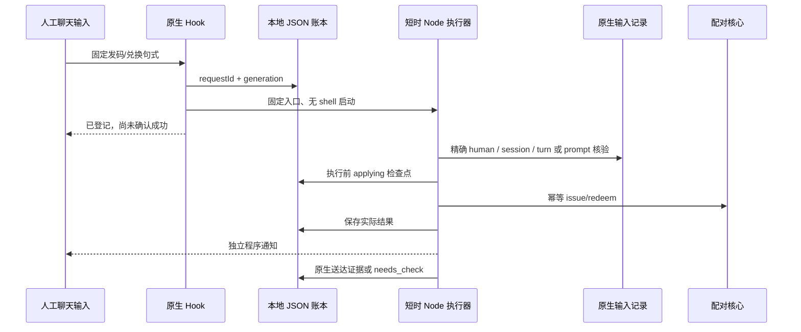

# 程序自动配对

自动模式把发码、兑换交给受限本地程序。模型可以不调用任何配对工具；仍需用户在原生主聊天真实输入固定句式，Hook 已加载并受信任，且原生记录能证明来源。当前默认 `manual`，升级不会自动启用。

## 用户流程

1. 安装更新并审阅自动执行范围后，执行 `labus pair mode --mode auto` 预览，再以 `--apply` 明确启用。此配置属于当前用户安装，覆盖两端已加载的 Hook；不以工作目录定位窗口。
2. 在目标聊天输入 `生成连接码`。程序核验这次人工输入，保存码与一小时有效期，向这个精确聊天投递程序通知。
3. 在另一端聊天输入通知中的 `连接 Claude，连接码 XXXX-XXXX` 或 `连接 Codex，连接码 XXXX-XXXX`。程序核验本次兑换来源，执行既有配对核心；可按既有规则安全替换空闲旧连接，保留历史。旧连接忙或待核对时不强行切换。
4. 发码仅是邀请；身份配对完成也不代表业务任务通过。委派、工具审批和任务验收仍走原流程。

Hook 的“已登记”不是成功回执。模型正常结束当前回合，原窗口才有机会消费通知。模型可能错误解释状态；以程序账本和原生证据分别核对，不依赖模型记消息编号或自行回信。

## 实际机制



`jobs.ts` 管模式、generation、32 个未决任务上限、原子 revision 更新；`executor.ts` 与手动 CLI 共用既有核心；`worker.ts` 管启动/退出握手、200–1000ms 退避、两分钟原生证明期限与精确恢复；`notifications.ts` 使用独立通知账本，复用原生证据读取器，不创建业务任务、不启动另一个 Agent。`operations.ts` 将显式恢复和手动执行也登记到安装互斥保护中；仅登记/退出时持有安装锁，不在核心事务等待该锁。

通知只投递经证明的原聊天：Claude 使用精确 session 的本地端点与 transport UUID；Codex 用 App Server 的 `thread/queue/add` 和稳定 client ID，绝不 `queue/start`、创建或恢复别的线程。写入回执不是送达证据。`unknown` 只核对同一 transport ID，不自动重投；本实现选择零次自动重试。离线结果保存在账本，恢复后按精确请求查询或恢复。

通知的持久化投递检查点可在核心请求过期清理后独立核对，只读取原生证据，不据此再次发送。原生身份始终无法确认的请求只保留失败账本，不向未经证明的聊天发通知；可用 doctor/result 排障。

## 查询、停用、恢复

```text
labus doctor
labus pair result --request <精确 requestId>
labus pair recover --request <精确 requestId>
labus pair mode --mode manual
labus pair mode --mode manual --apply
```

`doctor`、`result` 只读。`doctor.automation` 列出模式、worker、任务阶段与通知状态，不输出连接码、端点令牌或聊天正文。多个请求不能猜最近一个；内部 ID 由诊断工具取出，日常聊天通知不展示协议编号。

`recover` 是显式状态操作：已成功的配对不再执行；已 claim 的激活按同一 ID 恢复；通知仅核对原投递。配对结果与通知错误独立返回。`result.data.codeExpired` 指出码是否超时；原结果保留供核对，不等于码仍可用（也可能已使用或被新输入撤销）。

停用不强杀进程、不取消已开始事务；无法取得锁时明确报忙，需待事务结束再停用。停用/重启用产生新 generation，旧请求不会自动补跑。升级与卸载会拒绝活动 worker，不能只检查 Bus。卸载停止自动准入，保留配对与历史，不强杀 Agent。

已结束任务在下一次登记时清理超过 24 小时的记录；未决恢复和投递待核对记录不清理。连接码与任务结果属于本机同用户状态，不提供对同一系统账户恶意进程的隔离。

## 启用范围与限制

自动模式允许可信 Hook 后台执行精确人工配对操作，**不再要求模型逐次申请 Bash/exec 工具审批**。它只允许发码、兑换、符合既有准入的空闲换绑与结果通知；不能执行任意 shell、改业务代码或更改原生权限。启用前需审阅具体安装增量；原生 Hook 信任仍由用户确认。

使用 JSON 文件，无 SQLite、额外 API 服务、新的常驻 daemon。安装更新与显式 opt-in 前，当前连接、运行时与用户配置均不变。

离线测试能证明账本、精确人工来源拒绝规则、故障恢复、调度和通知协议调用；不能代替两端原窗口送达验收。特别是新未配对聊天、原窗口忙/重开及 Codex 队列消费，必须核对实际原生记录；下文分别列出本次现场已验证和仍待验证的范围。

## Windows launcher boundary

`process.ts` loads the shipped fixed `launch-worker.ps1` through a short encoded entry. It resolves cmd/PowerShell in the system directory with an explicit trusted cwd; no peer text enters a shell command and no execution-policy configuration is changed. The worker is created suspended with explicit native breakaway. Its exact PID is durably registered before a permit lets it run. Creation/permit deadline is 3 seconds; helper wait is bounded at 3.5 seconds. A job that forbids breakaway fails closed, without WMI, scheduled tasks, elevation or another user.

Isolated Windows tests cover long paths, Chinese/spaces, inherited process-only Restricted policy, survival after the owned Hook job closes, refusal when breakaway is forbidden, uncertain-start PID guards, and installer shipping. An abrupt helper death between suspended creation and receipt can leave a suspended process; arbitrary instruction-level crash cleanup is not guaranteed. These tests do not prove real native-window delivery.

## Service readiness

IPC health and state-changing requests are rejected with `bus_initializing_or_closing` until recovery, diagnostic descriptor creation, timer assignment and signal handlers finish. A listening pipe alone does not make the service ready. This prevents an immediate shutdown from completing before startup later creates its polling timer. A deterministic blocked-recovery regression covers this ordering.

## 2026-11-19 本机验收记录

本次在原 Codex Desktop 与原 Claude Code 聊天核对程序账本及精确原生回合，不以模型口头回执代替送达证据。

| 范围 | 实际结果 |
| --- | --- |
| Claude 人工发码 → Codex 人工兑换 | 程序签发、兑换及双方程序通知已验证；模型未执行配对工具。 |
| Codex → Claude 两轮任务 | 1763 → 1764，两个原始回复均为 delivered。 |
| Claude → Codex 两轮任务 | Bus 更新重启后，3127 → 3128；第二轮关联第一轮回复，同一任务族，两个自动回复均在原 Claude 入站，状态 delivered。 |
| 服务修复安装 | 正常关闭原 Bus，仅更新 main.ts，启动同一连接；Hook、权限、配对及历史受保护文件哈希不变。 |
| 自动配对停用与恢复 | 官方命令 manual → auto，产生新 generation；旧请求未重新获准，空 worker 正常退出，连接、核心配对及旧任务账本不变。 |
| Codex 人工发码 → Claude 人工兑换 | 尚待相反方向的真实人工输入；任务双向通过不能替代这项身份入口验收。 |

一次旧反向 followup 继承的任务总预算仅剩约 82 秒，其 Stop 事件比截止时间晚 646 毫秒，最终 expired、未自动回传。本次保留该失败，没有重发、延长旧截止时间或将聊天中的答案算作成功。后续使用独立新任务族验证两轮通信。实际验收脚本应先检查剩余总预算，再安排接续。

原 Claude 的 auto 模式曾拒绝执行由 peer 指定的 Temp 助手代码；该次未发送反向任务。用户在原 Claude 明确授权后，Claude 使用已安装 labus 入口提交算术任务。配对及 Bus 消息不会自动授予另一端工具执行权限。

旧过期任务仍可能使 doctor 报告 connection_native_work_outstanding；它与新任务往返结果分开记录。没有用户明确选择，不自动归档或清除这些保护记录。本次不声称新目录、新聊天、两端真实退出重开、全部换绑场景都已现场通过。

本阶段最近一次完整离线回归为 384/384，失败、取消、跳过均为 0；私有原生会话标识、聊天记录、配置备份和完整证据不纳入公开仓库。
