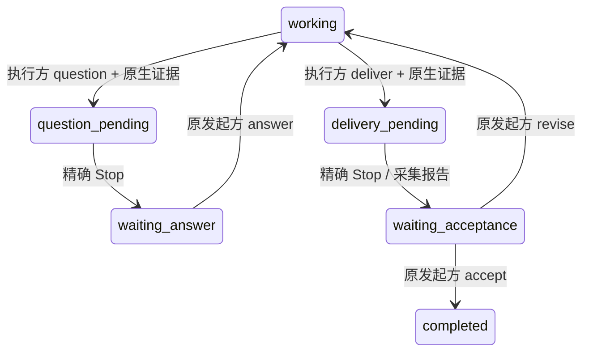

# 结构化协作（离线实现，待原窗口验收）

这是显式选择的新模式，默认 `ask` 与自动回传保持原行为。用户可说“把这个任务交给 Claude，使用提问和验收流程”；两端 Skill 负责查精确工具状态及调用命令，用户不需复制协议 ID。

Stop 只表示一个回合结束。没有显式 question/deliver 的结构化执行回合会进入 needs_check，不会猜报告语义。completed 表示发起方接受当前交付，businessVerdict 始终 unverified。普通信息回复不触发自动回信。

命令由 Agent 通过已安装入口执行，保留原生审批：
- `labus ask --provider <本端> --mode structured --text-file <任务>`（Claude 兼容参数另需本会话 source-session）。
- 动作共有 `question / answer / deliver / accept / revise`，必须带 `--provider <本端> --source-session <本聊天原生UUID> --task <精确taskId> --operation <新UUID> --revision <当前版本>`。
- question/answer/revise 带 `--text-file <正文>`；answer 另带 `--question <当前questionId>`；accept/revise 另带 `--delivery <当前deliveryId>`。deliver/accept 禁止正文。deliver 的最终报告由该精确回合 Stop 采集。
- `labus status --task <taskId>` 的 `data.tasks.collaboration` 展示业务阶段、固定双方、版本、问题/交付版本、预算。消息列表与协作账本分开；completed/delivered 的消息不意味着业务结束。
- IPC `collaboration-status` 单独支持 taskId、limit(1–100，默认50)、after；其游标独立于消息 status。CLI 不支持翻页，精确任务过滤可避免按“最新任务”猜测。

动作首先返回 pending_verification，随后后台核对原生工具结果的请求摘要、工具调用、精确会话和回合，再推进状态。执行方仅可在绑定任务执行回合提问/交付；发起方仅可在该任务的问题/报告接收回合操作，或通过经验证的人工来源操作。模型填写的 ID 不是权限证明。原生工具记录缺失、冲突、部分写入或超界一律不推进。

当前支持形态：Claude 主会话 Bash 单条已安装 launcher 命令，Codex 主会话 exec 中精确的 `text((await tools.exec_command(<JSON字面量对象>)).output);`。动作命令必须显式包含本端 sessionId，Windows PowerShell 可在命令起始使用单个 & 调用运算符；不接受任意 JS、shell 链或外部脚本代理。独立证据读取器限单文件16MiB、单行2MiB、目录2万项；超出限制保持未核验，不切到模糊匹配。现有 reader/适配器协议不变。

文件账本位于连接 state/collaboration/tasks 与 actions。intent 和 terminal 两个 checkpoint 分别先存确定性动作/消息，再提交任务版本；重启保留原 messageId，不重复扣预算。原始 TTL=30分钟，最多3个问题、6次执行（回答及修改会消耗），不会随对话刷新。超时不等于原生取消。等待答案、等待验收与未完成动作均阻止连接切换和卸载；需要用户明确处置，禁止自动删除保护记录。

异常排查：用原 task/operation 查询状态，保留文件、消息和原生记录；不得换 ID 重投或把未知送达当失败后重试。needs_check、revision_conflict、action_unverified、budget_exhausted、storage_requires_check 分别需要核对精确回合/当前版本/原生证据/剩余预算/原始存储。stop 只停止 Bus 追踪，不取消厂商进程。

本次不修改真实安装、Hook、模型权限或配对，也未验证真实厂商窗口中的结构化工具调用。离线集成使用真实 Bus/存储/IPC/clean 处理器与替身厂商接口；完整测试与独立审查结果另见 verification 报告。Skill 的文本契约和离线行为场景不保证每种模型都能可靠执行，最终动作准入由程序校验。
