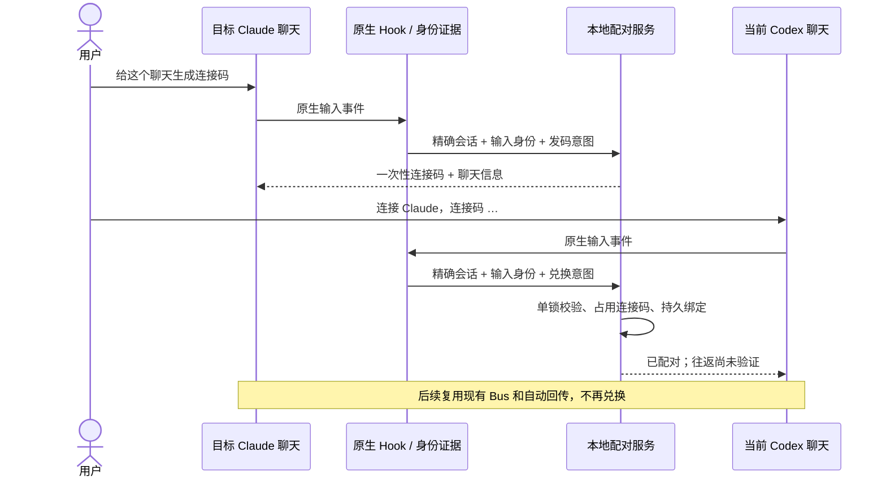

# AgentWire：一次性连接码最小设计

日期：2026-11-17。状态：待书面审阅；产品代码、安装配置与当前连接均未改动。

基线：AgentWire `f77b2d0051fda7049c7453b8e6a6e67ef1172382`（0.1.1）。

## 1. 用户目标与取舍

用户要把当前 Codex 聊天与自己指定的已有 Claude 聊天连接起来；标题相似、同目录、多窗口和恢复聊天时，也不能选错。日常直接在聊天中委派，不要求用户辨认或抄写 Session ID。

采用“目标聊天发码、发起聊天兑换”的首次配对方式。它比候选列表多一次复制，但用户亲自在目标聊天操作，指向更明确；列表仍作为旧版备用入口。暂不做自动猜窗口、桌面选窗 UI、二维码、连接别名、多组并行连接或第三个 Agent。

本设计的难点是原生身份与操作来源验证，而不是随机码生成。仅有一个模型填写的 `--source-session`，不能证明命令来自那个聊天。P0 必须先验证两端原生能力，未通过时停止后续实现并报告具体缺口。

## 2. 最小用户流程

1. 在目标 Claude 聊天输入：`给这个聊天生成连接码`。
2. Skill 调用本地客户端，展示：聊天标题、工作目录、一次性代码（例如 `7K4M-9Q2R`）、一小时有效期。标题仅帮助人确认；程序绑定原生会话身份。
3. 回到当前 Codex 聊天输入：`连接 Claude，连接码 7K4M-9Q2R`。
4. 程序校验两端身份并保存连接，展示双方聊天与目录。成功提示：`已配对；实际任务往返尚未验证。可以发送第一条任务。`
5. 用户说“让 Claude 审查刚才的修改”，沿用现有 ask、自动结果回传和 followup。

Codex 发码、Claude 兑换完全对称。首版接受上述固定句式；Skill 可以引导用户发送固定句式，但不能从其他模糊请求自行合成一次已获原生证明的操作。扩大自然语言同义表达留到后续。

配对本身不派发算术题、不自动委派、不向双方聊天注入协议编号。首次真实任务的实际证据用于分别记录两个方向的往返情况。

## 3. 架构与来源证明门槛

优先复用已安装 Hook router：在“未配对直接返回”之前，仅识别明确的配对控制输入，形成短时操作凭据。凭据必须包含 provider、原生 sessionId、原生输入/回合身份、工作目录、意图、捕获时间；Hook 与原生记录共同验证其属于该主聊天的真实用户输入。

P0 需证明：①未配对聊天也能获得这些身份；②能区分主聊天用户输入与 peer/channel 注入、工具输出及子 Agent；③能把对应的唯一操作凭据交给当前聊天的客户端调用，而不是读取“最近一条 Hook”；④两端当前版本都可用。可以使用原生 Hook 的上下文输出能力或等价的原生关联，但必须记录实际字段和实际证据，不能假定它们存在。

若 Hook 本身不能证明来源，只可结合可核验的原生记录补足。若仍有歧义，返回 `pairing_identity_unconfirmed`。不得退回模型填写 UUID、按 cwd/标题/PID 猜会话、仅凭正文匹配或“最近活跃”关联。普通输入、peer 正文和工具输出不得被采集为配对意图。

## 4. 固定参数与数据

- Windows；Node.js >=24；TypeScript 原生 strip-types；零新增运行依赖。
- 仅一组活动 Codex↔Claude 连接；继续使用现有 CLI 名称 `labus` 和安装目录。
- 代码：密码学随机生成 8 个 Crockford Base32 字符，显示 `XXXX-XXXX`，有效期 3600 秒，一次性。接受大小写和可选中间连字符；不把 O/I 等相似字符猜成数字。
- 操作凭据有效期 120 秒。凭据精确绑定一次原生输入及 issue/redeem 参数；凭据 ID 只是后台关联，不让用户抄写。
- 本地 JSON、现有独占锁和原子写；不用 SQLite 或第三方 API。
- 配对状态文件上限 256 KiB、最多 128 条凭据/邀请/事务记录（合计）；先清理已过保留期的终态记录，仍满则拒绝新建，不删除未完成事务。终态记录保留 24 小时后可清理。
- 同一会话再次明确发码，撤销该会话尚未兑换的旧码；同一操作凭据重试返回同一结果。代码只在本地短时状态和发码结果出现，不进入常规日志、Git、公开证据或错误回显。此为同一 Windows 用户下的防误配机制，不是恶意本机进程之间的安全隔离。

数据分为：`PairIntent`（原生来源与明确操作）、`Invitation`（代码、发码者、期限、状态）、`PairActivation`（兑换者、唯一 connectionId、激活进度）、连接记录。普通聊天不新增落盘。

连接记录新增明确的 `schemaVersion:2`、`admissionMode:'identity-pair-v1'`；旧的 `schemaVersion:1` 和算术探针验收保持原语义，不自动迁移或把旧 `needs_check` 改成成功。新记录不伪造 probeIds。

## 5. 配对事务与恢复

使用安装根下现有 `connection.lock` 串行化发码、兑换及连接激活。不得在持有同一锁时调用再次取锁的 selectConnection。拆出小型连接激活入口，复用现有 Bus、端点绑定、路由文件和服务管理。

兑换顺序：

1. 核验原生操作凭据、代码、有效期、对端 provider 和精确会话；核验目标当前仍能确认身份。离线或不确定不换成其他目标。
2. 检查已有活动连接。不同连接不自动覆盖；相同双方的连接可以幂等返回。用户须先使用现有断开/显式归档流程处理其他连接。
3. 原子写入代码已被该操作占用的 activating 事务，同时固定 connectionId 和双方身份。
4. 写连接记录，准备对应服务状态，向 Bus 绑定双方，保存精确路由。
5. 最后提交 active-connection 指针与 paired 状态；记录兑换结果。整个过程不发送 Agent 任务。

这些文件不是一个原子事务。每个写入边界都须有恢复测试：重启后按已占用的同一 connectionId 补完，不另建连接；遇到路由、服务或活动指针冲突进入 `needs_check`，不发任务。占用后超过一小时也只能由原兑换凭据恢复，不能重新把码交给别人兑换。连接码“已使用”不会因重启复活。

同一原生会话恢复后重新解析其端点；PID 变化不改变身份。同标题的新会话必须重新配对。旧任务和迟到回复始终保留旧 connectionId 与 targetSessionId；新配对不搬运旧 outbox、execution 或 result。

## 6. 状态与错误语义

分开报告三项事实：

| 事实 | 可报告值 | 证据边界 |
|---|---|---|
| 身份配对 | confirmed / unconfirmed | 双端原生来源与持久绑定 |
| 端点/能力 | detected / offline / unsupported / unknown | 进程/端点发现或能力检查，不等于消息已到达 |
| 实际任务往返 | untested / observed，逐方向记录 | 现有准确的任务、原生回合、自动结果及回复送达证据 |

现有 Claude adapter.probe 只解析端点；Codex adapter.probe 只检查 queue 能力。两者均不能单独显示“通道已接通”。新 paired 记录允许用户显式发送首个任务；服务或端点无法确认时报告错误，投递后不确定仍沿用 needs_check、禁止盲目重发。业务成功依旧由测试和用户验收决定。

稳定错误码至少覆盖：`pairing_identity_unconfirmed`、`pairing_intent_expired`、`pairing_code_invalid`、`pairing_code_expired`、`pairing_code_used`、`pairing_provider_mismatch`、`pairing_target_unavailable`、`active_connection_exists`、`pairing_activation_requires_check`、`pairing_store_limit`。错误不回显代码，不触发另一会话备用投递。

## 7. 最小改动范围

新增 `src/pairing/` 的 model、capture、store、service、cli 五个小模块。修改 installation 的 model、hook-router、connections 及 labus 命令分派；更新双方 Skill、使用文档和有针对性的测试。尽量复用 paths、service、adapter 与现有 Bus；不重写传输层。

P0 是临时验证，先出证据报告再做持久模块。预计 0.5–1 个开发日验证来源，2–3 日实现与离线故障测试，0.5–1 日真实窗口验收和交付；合计约 3–5 个开发日。此为单人熟悉现有源码的工程估计，不是已验证工时。P0 不通过时不继续累计实现。

## 8. 验收与激活边界

离线覆盖：过期/重放/竞争兑换、同标题多会话、普通聊天和 peer 混入、逐写入崩溃恢复、旧连接不变、旧回复不串线、旧版探针不变。真实验收用两个已有聊天：两端分别发码兑换；每方向一次任务和 followup；同会话正常退出恢复；新会话不继承；全程不要求模型复述 ID。

不在本次文档阶段运行探针、修改当前配置或发布。实现先在隔离工作区完成；真实探针和安装变更先准备明确差异，沿用现有授权边界与原生 Hook 信任，不修改审批权限。P0 通过、离线测试通过和真实窗口通过分开报告。

## 9. 源码依据

- `src/installation/source.ts:readCallerSource`：Codex 原生环境身份；Claude 当前可接受 Skill 提供的 sessionId，不能直接当新配对来源证明。
- `src/installation/hook-router.ts:routeHook`：未匹配已配对路由时直接返回；新控制输入须在此前单独处理。
- `src/installation/connections.ts:selectConnection/beginProbes/inspectConnection/askPeer/disconnect`：当前单活动连接、双向算术探针、ready 准入和旧原生任务保护。
- `src/installation/paths.ts:acquireLock/atomicBytes/safePath`：现有本地锁、原子写与路径保护。
- `src/adapters/claude.ts`、`src/adapters/codex.ts`：端点发现、队列能力与提交收据的实际边界。
- `src/native/claude-evidence.ts`、`src/native/codex-evidence.ts`：原生输入身份与 peer 关联；字段是否足够支持未配对来源证明，仍须 P0 实测。
- `assets/skills/{codex,claude}/labus/SKILL.md`：现有聊天入口与工具审批约束。

路径均相对本仓库，基线固定为文首 commit；上述新配对机制属于设计，尚未实现。
