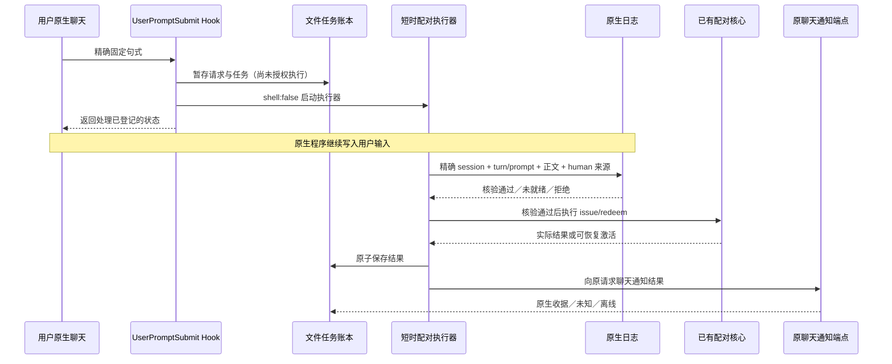

# 配对由程序执行：设计与验收契约

日期：2026-11-18（Asia/Shanghai）。状态：设计待用户审阅，未实现、未启用。

## 1. 目的与已确认的范围

用户希望在任一原生主聊天输入「生成连接码」或正式兑换句式后，由程序完成配对；
不能依赖模型读取临时凭据、选择工具或正确执行 Skill。保留两端独立上下文、原生身份
核验、一次性码、一小时码有效期、安全空闲换绑、历史与业务权限。仅限本机；文件存储，
不引入 SQLite、额外 API 服务、新的常驻 daemon 或第三个 Agent。

本轮用户认可了聊天中提出的流程：Hook 登记精确请求，短时后台执行器等待原生证据，
程序执行发码／兑换，保存实际结果并通知原聊天。本文件细化其工程边界，尚未实施。

完成标准：即使模型没有调用任何配对工具，真实人工配对输入也能产生程序结果；
身份无法确认时明确失败；结果通知失败不重复配对。模型如何措辞与程序实际状态分别核验。

## 2. 源码事实与选择依据

- `src/installation/hook-router.ts:routeHook` 当前暂存请求后输出凭据，要求模型运行 CLI。
- `src/pairing/requests.ts:stagePairRequest/resolvePairRequest` 区分 Hook 相关性数据与
  经原生记录验证的意图。`src/pairing/capture.ts:verifyPairIntent` 明确指出 Codex 输入
  可能在 UserPromptSubmit 返回后才落盘；因此不能在 Hook 里同步等这条输入。
- `src/pairing/store.ts:issueCode/claimCodeLocked` 与 `service.ts:redeemCode/recoverPairing`
  已有幂等发码、激活账本、恢复与空闲换绑。复用它们，不另写一套配对协议。
- `src/installation/service.ts:spawnBackground` 提供 Windows 隐藏、无 shell 的子进程模式。
- `src/adapters/claude.ts:postClaude` 写入后返回 unknown，不能据写入成功推定聊天已收到。
  `src/native/dispatcher.ts` 已有先保存发送意图、再投递、最后按原生证据核对的模式。
- 本次实际故障：Claude 构造的模型请求含精确凭据与新版读取说明，但模型只查环境变量，
  没有执行兑换。不能靠继续加提示保证此步骤执行；代理后的最终请求尚未独立捕获。

比较三条路径：继续加强 Skill 仍依赖模型；Hook 同步等待有落盘时序问题；新增常驻控制
服务提高安装维护成本。选择 **Hook 快速登记 + 有界短进程**，不依赖活动 Bus 已存在。
首次未配对的新聊天也必须能发码，故不能只把执行器放在现有连接的 Bus 定时器里。

## 3. 流程

固定句式继续使用 `parsePairCommand`；不扩展自然语言猜测。Hook 输出“已登记、尚未确认
配对”的状态，不再把执行职责或内部凭据交给模型。通知正文不含可执行脚本或裸兑换句式，
携带结果说明时明确其程序通知来源，不能通过复制通知触发新的人工配对授权。

## 4. 执行器与文件账本

新增 `pairing/jobs/<requestId>.json`，以精确 requestId 定位，禁止查最近请求或填会话参数。
任务保存 schemaVersion、requestId、创建时间、原请求语义摘要、执行状态、规范化 intentId、
activationId、结果与错误码、通知状态。目标身份从已验证请求取得，不信任任务文件里另填的
路径／身份；凭据不出现在普通日志、命令输出或通知正文。

执行阶段：`waiting_native → verified → applying → succeeded / failed / needs_check`。
通知独立为 `pending / attempted / delivered / needs_check / offline`；配对 succeeded
不会因通知离线被改成配对失败。状态更新使用现有原子写、哈希校验与有界 JSON 读取习惯。

Hook 只登记并安排一次启动，不持有 connection.lock 等待原生输入。每安装最多一个短时
协调进程，使用带 PID 的启动／工作锁，最多处理 32 个登记任务，达到上限给出明确错误。
启动参数是固定入口、安装根和内部工作模式，全部用 spawn 参数数组，`shell:false`、
`windowsHide:true`。用户输入、连接码和对方正文不能拼接进 shell。

执行器每次只处理账本里的精确任务，发现当前安装无待处理工作即退出，不常驻。
原生证明未就绪时以 200ms 到 1000ms 的有界退避观察，最长不超过本请求已有的两分钟
期限；区分“尚未就绪”的重读与身份不符的拒绝，超期不签发凭据。等待期间不占全局连接锁。
同一聊天的不同输入保持独立，不因正文相同合并；同一 request 重复 Hook／启动只处理一次。

启动与退出在同一短时调度锁下握手：登记任务后检查接受工作的 worker 标记；执行器退出
前在锁内再次扫描，确认无工作才将标记改为不接受工作。后续登记不能仅凭旧 PID 存活就
认为请求已被接管；必须确认接受状态，否则安排下一代执行器。工作锁不因租约到期被
抢占仍活着的进程；PID 不确定时暂停，防止漏执行或双写。

协调进程退出后，下次真实 Hook 或显式 `labus pair recover` 可恢复精确任务。恢复入口不
选择最新任务：有多个未决任务时列出并要求明确选择。不得在程序更新后自动执行历史上
模型未处理的旧请求；只有新模式启用后登记的任务可被自动调度。

## 5. 配对核心复用与幂等

新增 `executePairRequest` 为自动任务与原 `pair issue/redeem --intent` 共用的执行入口。
先用原生证明解析 request，再进入已有 issueCode／redeemCode；CLI 与后台并发时，以同一
request/intent 加任务锁及既有 connection.lock 串行化，返回同一程序结果。
旧版手动调用不会额外签发第二个码、撤销本轮已生成码或创建第二份激活。

崩溃点必须覆盖：意图已验证但任务未更新；码已签发但结果未落盘；激活已 claim 但任务未
保存 activationId；结果已保存但通知未写出。恢复通过原 intent 对应的 invitation／activation
重建结果，不猜测活动连接就是本任务的成功结果。

未 claim 的兑换不得越过原意图期限；已 claim 的激活允许按既有 `recoverPairing` 接续同一
事务，不把恢复权限泛化为任意过期请求。发生外部冲突或存储错误时保留账本和保护记录，
不自行删除保护、不切换其他窗口、不归档未决任务。

空闲换绑复用现有 replacement：新目标核验、旧连接成员身份、四类工作计数、路由／绑定
校验、保护、正常退出和再次检查。模型说“空闲”不构成依据。发码成功不等于已连接，
identity paired 不等于任务往返通过。

## 6. 通知与可观察性

通知直接定位请求中已核验的 provider + sessionId，与当前活动配对无关。发码阶段通常还
没有连接，不能把通知作为现有业务任务家族的一条 reply；建立独立通知收据，复用现有
底层端点解析、App Server 队列及原生证据读取逻辑，不改变业务 Bus 队列。

先持久保存稳定 notificationId／transportId、正文摘要与原生查询锚点，再写出一次通知。
Claude 只用唯一精确活端点；Codex 只给精确原线程入队，不创建／恢复新线程，不从独立
App Server 强行 queue/start。原聊天正常空闲后能否消费通知必须现场验证。

unknown 写入只核对相同 transportId，不换 ID 重投。明确未写入时可在本短进程存活期间
最多重试两次；写入尝试前必须检查码是否过期和任务期限。通知首次写出前按当前状态
渲染，过期时不展示可用码；一旦开始写入，正文与 transportId 固定，不因后来过期改写
正文后重投。晚到通知携带明确有效期，查询时按当前时间显示已过期。离线时保存结果，
明确需恢复后查询；
`labus pair result --request <精确ID>` 提供只读查询，多条候选不猜最近记录。

程序状态、原生送达与模型是否正确复述是三项独立证据。即使模型错误声称失败，已保存的
配对事实不回滚；不能宣称通过通知就能强制模型准确回答。MVP 必须验证两端能在原窗口
看到通知，否则只交付已验证的自动执行和结果查询能力，并明确通知适配未通过。

状态中展示执行阶段、精确聊天标题／目录、请求过期、结果和通知状态；普通日志只记 ID、
阶段、耗时和错误码，排除连接码、票据、端点令牌和完整聊天正文。发码结果文件包含码，
按现有本机同用户文件访问边界保存，码一小时失效；任务终态最多保留 24 小时，未决恢复
记录不因清理丢弃。此方案不提供抵御同一 Windows 账户恶意进程的隔离。

## 7. 权限与启用

这是从“模型提出工具命令，经原生工具审批”变为“可信 Hook 启动受限配对程序”的执行
方式变化，不能声称仍逐次使用原 Bash／exec 审批。安装前须展示并取得该受限自动化范围
授权，保留原生 Hook 信任审核。允许的动作仅为精确人工句式对应的本地发码／兑换、
符合既有空闲准入的换绑及结果通知，不包含任意 shell、业务文件修改或代码任务执行。

使用用户级显式 opt-in，默认仍为 manual；未启用时保持旧入口。自动模式的任务文件登记
必须发生在 opt-in 生效之后。禁用后不启动新配对动作；已 claim 事务保留可明确恢复，
未执行任务标记停用，不在下次重新启用时突然执行旧输入。卸载保留配对、任务及消息历史。
业务命令审批不变，不修改 cc-switch、模型供应商、原生权限或其他 Hook。

运行时升级／卸载同时检查活动配对执行器；有执行器时先停止准入并等待已开始的事务
完成或明确暂停，再更新文件，不在进程读写模块时替换运行时。不能只沿用当前仅检查
连接 Bus 的 active-runtime 标记。失联 worker 与未决激活保留记录，拒绝静默强杀或覆盖。

## 8. 文件责任与实施分段

| 文件／模块 | 责任 |
|---|---|
| `src/installation/hook-router.ts` | 模式判断、登记与调度；快速返回，不执行模型工具 |
| `src/pairing/jobs.ts`（新增） | 有界账本、幂等、原子状态、查询、请求锁与恢复 |
| `src/pairing/worker.ts`（新增） | 短进程协调、原生证据观察、期限与启动锁 |
| `src/pairing/executor.ts`（新增） | 自动／手动共用程序执行入口，恢复既有核心结果 |
| `src/pairing/notifications.ts`（新增） | 独立结果通知、稳定身份、投递与原生核对 |
| `src/pairing/cli.ts` 与 `src/labus.ts` | 保留旧命令，增加只读结果与精确恢复入口 |
| 安装器与两端 Skill | opt-in、禁用和诊断；Skill 只解释／查结果，不承担配对执行 |

先实现并离线验证账本、执行、崩溃恢复；再验证两端未配对聊天的通知；最后准备具体安装
增量，启用后做真实人工输入验收。通知能力不能用已配对聊天的普通往返替代验证。
此顺序为设计分段，不是尚未审阅的实施计划。

## 9. 验收矩阵与停止条件

1. 模型不调用任何配对工具；两端人工输入均完成发码和兑换，状态匹配精确聊天。
2. 同标题、不同目录、两个新聊天、一个旧窗口换新窗口，身份与路由均不误配。
3. Hook 已返回但日志尚未落盘，执行器等待；peer、工具、子 Agent、歧义／多输入拒绝。
4. 重复 Hook、双进程启动、自动／手动并发、同正文新输入，分别满足幂等或独立执行。
5. 请求超期、码过期／已用、方向错误、目标离线、旧连接忙或未决投递，不擅自换绑。
6. 所列持久化边界逐一注入崩溃，恢复保持原 invitation／activation；不重发业务消息。
7. 通知正常、原窗口繁忙、重开、离线、写入 unknown、到达重复，结果不丢且不重复配对。
8. 无 Bus、无活动配对时，未登记的新聊天仍可自动发码并收到对应程序通知。
9. 自动模式关闭、配置被外部改写、原生 Hook 未加载／未信任／审批拒绝，不伪造成功或
   通过另一个入口绕过。禁用与卸载后无新配对后台任务启动。
10. 限额、坏 JSON、锁占用、启动失败、原子提交失败和只读查询不写状态均有证据。

离线测试通过、安装一致、程序配对通过、原生通知送达、真实业务协作分别报告。
任一身份准入或通知语义无法在原窗口证明时，保留具体失败记录并缩小结论；不以模型回复
“已连接”、相同正文或端点存在代替原生证据。

## 10. 本轮边界

本轮只新增本设计文档并保存审阅记录。不修改产品代码、安装、当前连接、原生配置，
不执行任何历史码或请求，不推送或发布。已有未提交的超时修复和自动换绑改动保持原样，
本设计提交只包含本文件。用户审阅本设计后再编写实施计划并选择执行方式。
