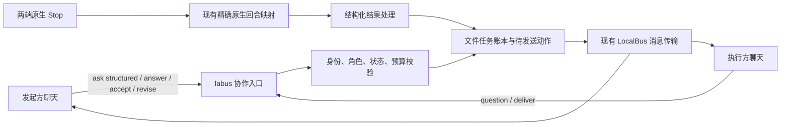

# AgentWire 结构化协作任务设计

日期：2026-11-20  
状态：书面设计待审阅；尚未开始产品实现  
源码基线：ae7177e9e92c46907dff74c4ef1d99947a8c3993  
工作区：E:/projects/agentwire，codex/local-connections-p0

## 1. 用户目标与约束

让一方委派任务后，执行方可以就原任务提问、得到答案后继续工作，再明确交付成果；发起方可以验收，或者要求同一任务继续修改。
Stop Hook 只证明一个原生回合结束，不能靠自然语言猜测任务是否已经完成。
Claude 和 Codex 都能发起任务，但对某一个任务，发起方与执行方的身份固定，问题始终送回该任务的发起方。

保留双方独立上下文、原生登录及审批。本机通信，文件持久化，不引入 SQLite、第三方 API 或外部服务。
现有 ask/followup 与自动回传默认行为保持兼容。新功能仅对显式选择 structured 模式的新任务启用。
本次代码开发与离线测试不修改当前安装、用户 Hook、模型配置、活动配对或历史记录。

## 2. 已核对的现有实现

- src/model.ts：MessageInput.kind 仅有 task/reply/followup；MessageState 是消息流转状态。
- src/bus.ts：acceptOne 收到非迟到 reply 时，把父消息更新为 completed 并保存 resultRef；不是业务验收。
- src/bus.ts：applyCapturedResultOne 由 CapturedResult 生成确定性 ID 的回复，businessVerdict 固定为 unverified。
- src/lifecycle/clean-processor.ts：通过 NativeDispatcher、IdentityStore 与 CleanTerminalHint 精确关联原生回合，再采集 Stop 结果；不能用“最新任务”替代精确关联。
- src/lifecycle/processor.ts：旧消息协议的自动采集处理；须防止绕过 structured 模式的策略。
- src/main.ts：单个 Bus 的 IPC 处理、串行调度、恢复与关闭入口。
- src/labus.ts：已安装聊天入口，调用 readCallerSource，并保存稳定的 outbox messageId；不是 MCP 服务。
- src/installation/source.ts：校验 provider 与原生/Skill session 来源；session 校验不等于已经证明某个具体原生回合。
- src/installation/connections.ts：askPeer/followupPeer 经活动连接、精确会话、连接锁与服务检查发送。
- src/installation/connection-management.ts：inspectConnectionWork 目前检查消息、原生派送和生命周期工件；尚无业务协作任务。
- assets/skills/codex/labus/SKILL.md 与 assets/skills/claude/labus/SKILL.md：安装时复制的两端 Skill 模板。

因此本次是新增任务子系统，不是调整 Stop 文案或给消息增加一个 completed 字段。

## 3. 方案选择

### 方案一：模型在最终回答里输出“完成/提问”标签
改动少，但依赖模型遵循格式，混合报告容易误判；不能满足用户“不靠回复可靠性”的要求。不采用。

### 方案二：显式协作动作 + 原生 Stop 采集 + 持久化任务状态（采用）
工具记录动作意图，程序根据角色和任务状态校验；Stop 只采集该精确回合的输出。
多一层任务状态，但保留现有传输、原生证据和文件存储，改造边界明确。

### 方案三：迁移到完整外部编排框架
能获得更多调度能力，但迁移安装、会话身份、权限和回传链路的成本较高；不符合本次最小实现目标。

## 4. 分层与职责

消息状态回答“投递/回合结果到哪一步了”；任务状态回答“业务还缺什么”。
两者分开存储和展示。旧 completed 字段不重命名、不改变语义。

## 5. 用户与工具接口

建议首版命令接口如下，具体选项在实施计划中冻结：

- labus ask --mode structured ...：创建显式结构化任务。现有不带 mode 的 ask 保持原样。
- labus question --task <taskId> --text/--text-file ...：执行方提出一个问题。
- labus answer --task <taskId> --question <questionId> --text/--text-file ...：原发起方回答。
- labus deliver --task <taskId> ...：执行方登记本轮最终交付意图，然后正常输出最终报告并结束回合；命令本身不伪造报告、不代表已经交付。
- labus accept --task <taskId> ...：发起方明确验收最近一次交付。
- labus revise --task <taskId> --text/--text-file ...：发起方要求继续修改，仍属于原任务。

各动作有稳定的 operationId，重试同一动作不能派生重复消息或重复消耗预算。
用户通过聊天自然语言表达意图，Skill 调用命令。聊天正文不显示协议 ID；工具内部允许使用明确的任务/问题 ID。
自动回传不依赖模型记住 messageId。动作若遗漏或关联不明确，暂停核对，不能猜测。

提问、回答、交付意图和验收都需要程序校验。工具成功只证明动作已登记，不证明答案正确或业务测试通过。
普通回复消息的接收回合没有待执行任务资格，Stop 不自动产生回信。

## 6. 状态机与角色

建议状态：

- working：等待执行方处理当前执行回合。
- question_pending：问题动作已登记，等待该原生回合结束；问题尚不能提前触发对方回答。
- waiting_answer：问题已可靠提交，等待原发起方回答。
- delivery_pending：交付意图已登记，等待该原生回合的 Stop 与完整报告。
- waiting_acceptance：报告已采集并提交，等待原发起方验收或修改意见。
- completed：原发起方显式 accept。
- needs_check：原生身份/回合冲突、缺少动作、错误、中断、交付不确定、存储损坏等，需要检查。
- expired / stopped：到期或显式停止；不声称原生 Agent 已被取消。

允许的主路径：

working → question_pending → waiting_answer → working
working → delivery_pending → waiting_acceptance → completed
waiting_acceptance → working（revise）

角色规则：

- question、deliver 只能由固定 executor 执行。
- answer、accept、revise 只能由固定 initiator 执行。
- answer 必须指向当前唯一待回答 questionId；重复已回答的问题不能重新发送。
- accept/revise 必须针对当前交付版本；迟到的旧 accept 不能验收新版本。
- 首版每个任务仅允许一个待回答问题；同一个原生回合只允许一个终结动作（question 或 deliver）。
- 同一 session 可以参与多个任务，但每个工具动作都必须有唯一的精确关联；不采用“最后一个任务”。

## 7. Stop 的处理

执行方 structured 回合：

1. 有精确 question 意图：确认该回合安全结束后提交问题，状态为 waiting_answer；不再自动转发额外的最终报告。
2. 有精确 deliver 意图：安全 Stop 后从原生证据采集完整报告，状态为 waiting_acceptance；不是 completed。
3. 两者都没有：needs_check，原因 action_required_after_turn；不擅自把自然语言分类成问题或交付。
4. 两者冲突、输出不完整、后台仍在执行、错误/中断：needs_check；不当作最终成果。

发起方收到问题/交付后，Stop 本身不回信；只有显式 answer/revise 才产生下一次执行消息。
普通人工聊天、无关回合、reply 通知回合不能绑定成任务动作或任务结果。

question 等待 Stop 后再发送，是为了避免对方回答已启动，而提问方旧回合尚未结束造成重叠。
deliver 登记与报告采集分两步，保证工具调用后产生的最终报告能完整进入结果。

## 8. 身份、存储与恢复

每个任务固定记录：taskId、connectionId、initiator/executor 的 provider+sessionId、初始请求、phase、deadline、revision、预算、当前问题和交付引用。
每个动作记录：operationId、taskId、actor、动作、输入摘要、期望版本、精确原生回合引用、待发送内容、提交阶段与结果。
精确原生回合引用使用既有 ExecutionRef（provider、sessionId、nativeExecutionId），并交叉校验 NativeDispatcher/IdentityStore 的消息关联。
只知道 sessionId 不能替代具体执行回合证明。工具参数中声称的回合 ID 也不能单独当作原生证据。

新增状态建议位于 connections/<connectionId>/state/collaboration/，复用现有原子写入、命名与访问边界。
单个 Bus 串行处理业务状态转换；动作先持久化，再提交消息，最后记录结果。禁止先发送再补账。
跨文件写入不是事务：恢复通过稳定 operationId、确定性 messageId 与提交阶段修复，不假设多文件写入同时成功。

- 意图已保存、尚未提交：重验身份、状态和 deadline 后提交同一个 messageId。
- 消息已保存、动作结果未投影：比对完整内容和路由后补投影，不创建新消息。
- 传输结果 unknown：needs_check，仅核对证据，不重发。
- Stop 已保存、投影未完成：重放相同 terminalEventKey，不重复采集或投递。
- 状态损坏、矛盾、残留无法证明：阻止相关动作和连接切换，不删除证据。
- 重启恢复 waiting_answer / waiting_acceptance；不把重启当作工作已完成。

## 9. 传输兼容与扩展边界

优先复用现有 task/reply/followup 传输与 clean-v1 原生映射，新协作语义保存在持久化任务账本，不直接把 question 加到旧 MessageInput.kind。
现有自动结果入口需要结构化策略分支，不能让 legacy/clean 两条生命周期路径重复回传。
问题与交付都要保留确定性回复关联，回答与修改仍关联原任务族；不通过新 ask 绕开任务预算。
若现有严格 transport 约束不能完整表达某一步，实施时应明确升级兼容协议及迁移测试，不能放宽旧校验让错误路径碰巧通过。

首版只支持 clean-v1 的新 structured 任务；legacy structured 请求明确拒绝，旧 legacy 自动回传仍受原测试保护。
后续第三 Agent 可复用角色与动作协议，但本轮不实现多执行方、嵌套子任务和跨机器路由。

## 10. 预算、防循环、权限和连接切换

首版建议沿用现有 30 分钟任务 TTL、最多 6 次执行回合；新增最多 3 个澄清问题。以上是设计默认值，实施计划必须统一固定并测试。
answer/revise 都消耗同一个任务预算，不能通过换 messageId 重置。重试同 operationId 不重复扣减。
超时冻结新动作和新投递，保留迟到事件；不能把超时理解为已经终止 native Agent。

收到 reply 不自动生成 question/answer/ask。真正的后续动作必须显式调用工具，并符合原用户任务授权。
不会阻止模型在别的独立授权任务中调用 ask，但它不能被视作本任务预算的一部分，也不提供防任意模型行为的全局保证。

所有 peer 数据继续是低权限数据；不改变工具审批，不从报告中提取高权限指令，不代替用户授权执行。
本轮不增加共享仓库写锁。继续遵守既有单写者/工作区约束，通信功能不证明并发修改安全。

disconnect、切换配对、自动替换、卸载都必须计入未完成协作任务。
等待答案/验收也算未完成，即使消息 completed/delivered；未获授权不得自动归档。
显式 stop/归档若已获用户授权，保留任务和事件并记录 disposition，不伪装成验收通过。

## 11. 状态与故障可见性

status 展示独立 collaboration 字段：角色、任务阶段、在等谁、当前问题/交付版本、剩余预算、deadline、最近错误。
不覆盖现有消息状态。用户看到“等待发起方回答”“等待发起方验收”“执行方结束但未声明动作”等具体原因。
报告保存业务结论 unverified；accept 显示“发起方已验收”，不冒充程序验证了测试正确性。

## 12. 代码责任边界

新增目录 src/collaboration/：
- model.ts：状态、动作、角色、预算及严格 schema 校验。
- store.ts：任务/动作持久化、原子更新、只读检查与损坏处理。
- controller.ts：串行状态转换、动作幂等、确定性出站消息及预算检查。
- lifecycle.ts：精确回合动作归属、Stop 解释与结果采集。
- recovery.ts：提交阶段修复、到期处理和不确定状态保留。

修改：
- src/bus.ts：结构化任务注册与结果策略接入，保留旧路径。
- src/main.ts：协作 IPC、初始化/恢复/调度/关闭。
- src/labus.ts：显式模式和动作 CLI、稳定出站 ID、参数白名单。
- src/installation/connections.ts：精确当前配对下的协作动作入口。
- src/lifecycle/clean-processor.ts、src/lifecycle/processor.ts：结构化归属和采集策略的单一入口。
- src/status.ts：并列展示协作任务状态。
- src/installation/connection-management.ts：未完成任务和不确定动作的切换保护。
- 两端 assets/skills/*/labus/SKILL.md：自然语言入口与动作规范。
- 必要的安装能力检查及版本说明：防止旧运行时静默忽略新选项。

具体接口签名、调用次序和每项红绿测试命令在书面实施计划中给出；本设计不等于实现已完成。

## 13. 验收标准

离线测试：
1. question → Stop → waiting_answer；只有原发起方能 answer，答案恢复原任务。
2. deliver → Stop → waiting_acceptance；只有原发起方能验收正确的交付版本。
3. 没有动作的 Stop 不完成任务；reply 的 Stop 不回信，连续回放不形成回声。
4. 错误角色、其他聊天、伪造/过期回合、同正文多个任务、普通聊天插入全部拒绝或忽略。
5. 重复动作、重复 Stop、先 Stop 后处理意图、提交各崩溃窗口不重复投递或计费。
6. 错误/中断、不完整报告、截止、预算耗尽、一方离线都保留可诊断状态，不盲重试。
7. 等待答案/验收时，连接切换/替换/卸载不得漏掉未完成业务任务。
8. 旧手动回信、旧自动回传、clean-v1 和既有连接管理全量回归通过。

真实窗口验收（产品安装另行准备具体差异后）：
- 双向各跑一个新 structured 任务。
- 一轮提问、一次回答、一次交付、一次明确验收；验证原会话/精确回合和无额外回声。
- 明确区分离线机制通过、真实窗口通信通过、业务开发任务通过。
- 原生执行审批若阻止动作，如实报告，不以 peer 文本替代授权。

## 14. 分期边界

首版要完整支持一个执行方的提问、回答、交付、验收与同任务修改，以及恢复、防循环和连接保护；不能只增加几个 CLI 名字就称为完成。
若精确回合工具身份无法由现有原生证据证明，必须先单独验证该边界，再接通新动作，不能降级为凭模型传 sessionId 就接受。
本轮不发布、不推送、不安装运行时、不切换当前连接；这些不影响在隔离工作区完成实现与离线验证。
